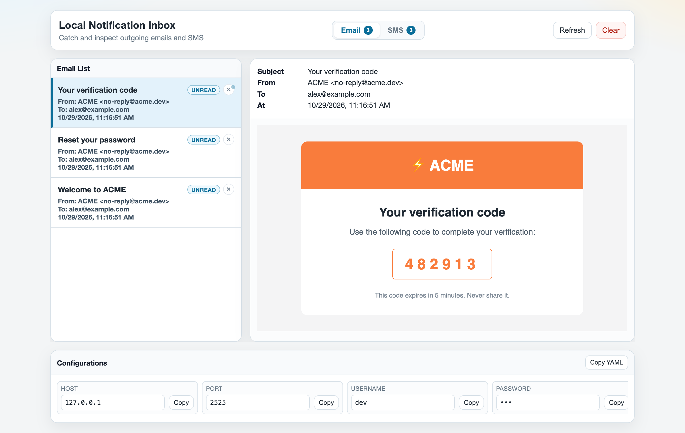
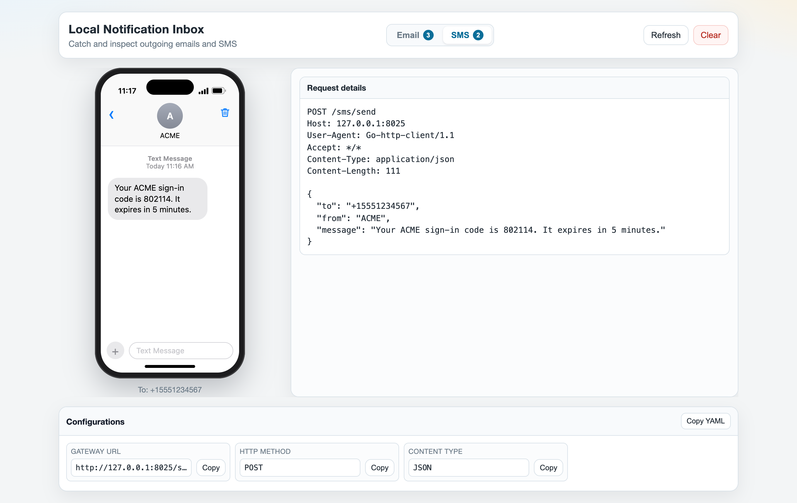

# Local Notification Server

A tiny local server for testing outgoing notifications. It captures emails over SMTP and SMS over an HTTP gateway, and shows both in one web inbox.

### Email



### SMS



## Prerequisites

- Python3

> YAML config works out of the box using the built-in parser. If you want full YAML feature support, optionally install PyYAML:

  ```bash
  pip install pyyaml
  ```

## Run

```bash
python3 server.py
```

The server will read `config.yaml` by default.

Default endpoints:
- SMTP: `127.0.0.1:2525`
- SMS gateway: `http://127.0.0.1:8025/sms/send`
- Inbox UI: `http://127.0.0.1:8025`

Open http://127.0.0.1:8025 and switch between the **Email** and **SMS** tabs.

## Config file (YAML)

Edit `config.yaml`:

```yaml
smtp_host: 127.0.0.1
smtp_port: 2525
smtp_username: dev
smtp_password: dev
smtp_auth_methods: PLAIN, LOGIN, CRAM-MD5
smtp_tls: false
http_host: 127.0.0.1
http_port: 8025
max_messages: 500
refresh_ms: 3000
```

The SMS gateway runs on the same HTTP host and port as the inbox UI. `max_messages` applies to emails and SMS separately.

CLI flags still work and override values from the config file.

## SMS gateway

`GET` or `POST /sms/send` accepts a JSON, form, or plain text body and returns `200` `{"status": "accepted", "id": ..., "message_id": ...}`.

Every request is accepted and stored. No credentials are checked.

The recipient, sender and text are read from these fields, case-insensitively:
- Recipient: `to`, `recipient`, `phone`, `phone_number`, `mobile`, `mobileNumber`, `msisdn`, `number`, `destination`
- Sender: `from`, `sender`, `sender_id`, `senderId`
- Text: `body`, `text`, `message`, `content`, `msg`

If no text field is found, the whole request body is shown as the message. The SMS tab shows messages on a phone view, with the full request (method, path, headers, body) under **Request details**.

Example:

```bash
curl -X POST http://127.0.0.1:8025/sms/send -H 'Content-Type: application/json' -d '{"to": "+94771234567", "message": "Your code is 123456"}'
```

## ThunderID config example

### Email

Use this in your [ThunderID](https://github.com/thunder-id/thunder-id) deployment.yaml file:

```yaml
email:
  smtp:
    host: "127.0.0.1"
    port: 2525
    username: "dev"
    password: "dev"
    from_address: "noreply@thunder.sky"
    enable_start_tls: false
    enable_authentication: true
```

### SMS

ThunderID's Twilio and Vonage connections call the real provider URLs, which can't be changed. Use an SMS gateway connection pointing at this server:

```bash
curl -k -X POST https://localhost:8090/connections/sms-gateway \
  -H 'Authorization: Bearer <token>' \
  -H 'Content-Type: application/json' \
  -d '{"name": "Local SMS Gateway", "url": "http://127.0.0.1:8025/sms/send", "httpMethod": "POST", "contentType": "JSON"}'
```

Notes:
- Use `contentType: JSON`. ThunderID sends the rendered SMS template as the request body. With `FORM`, only `key=value` lines are sent, so a plain text template arrives empty.
- ThunderID doesn't add the recipient to the request. The recipient shows as `Recipient not in payload` unless the SMS template body includes it, for example `{"to": "...", "message": "..."}`.
- Authentication (API key, bearer, basic) can be configured on the connection. It's accepted as is and visible in the request details.

## Optional flags

```bash
python3 server.py --config config.yaml --smtp-host 0.0.0.0 --smtp-port 2525 --http-host 0.0.0.0 --http-port 8025 --max-messages 1000 --refresh-ms 2000
```
